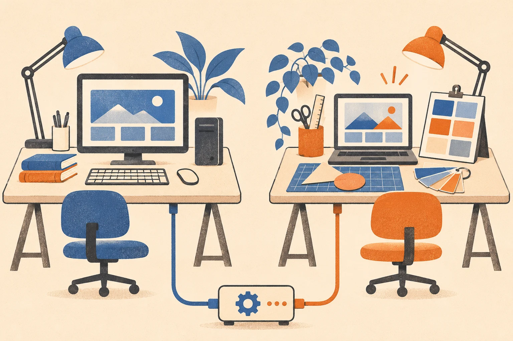
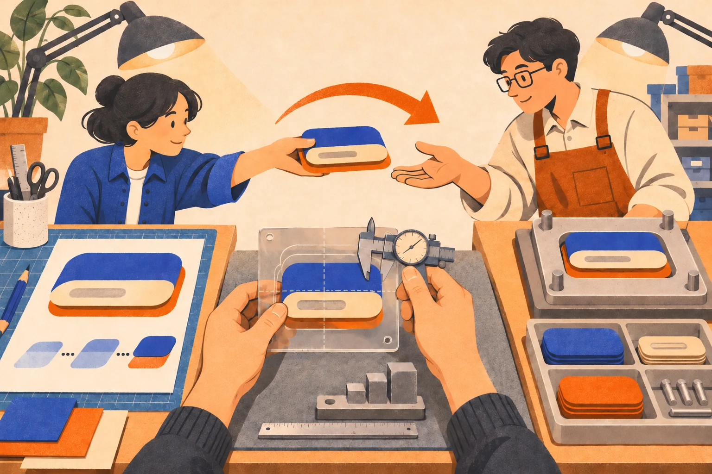
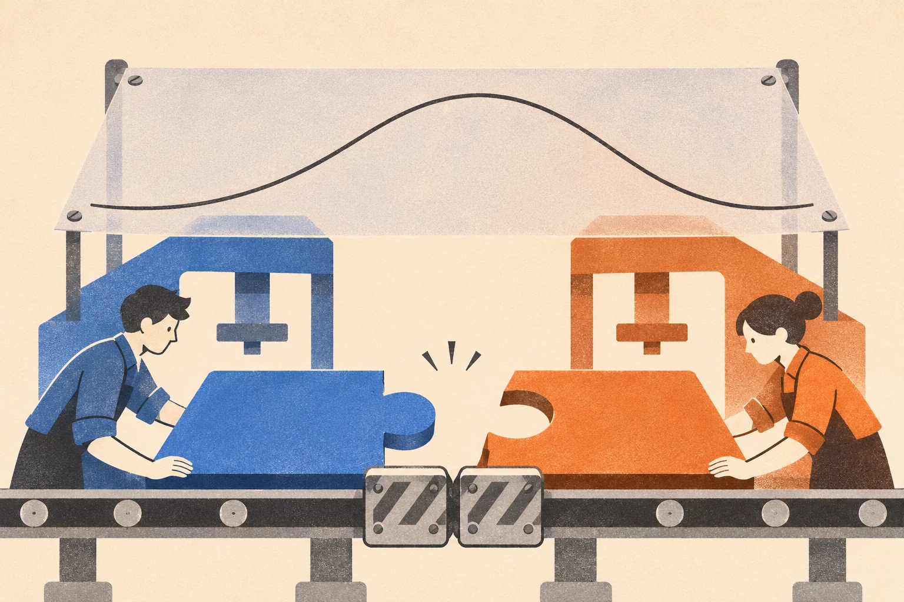

我试过把设计放进独立的代码工作区，再把界面和动效迁回正式前端，也遇到了团队变大后越来越难协调的问题。

<!-- more -->

## 先给现在的协作流程

主应用是分成了两个部分：

app-bff — Backend for Frontend。主应用前端处理 API 转发等服务。

app-fe-pc（AFP） — 正式 App 前端 Frontend，pc 指的是电脑端。

我单独又增加了一个 app-design-mock （ADM）工作区，从项目开始一个月之后复制的，后续就在这个工作区延伸了纯设计工作。

### 相比正式前端的特点

* 复用真实接口

现在的项目，接口是用了一个单独的 bff 转发，因此我的 design mock 也是可以接入的。这通常会比我自己做个假 Demo 来得更合适，因为真实接口意味着有真实数据，真实的响应速度。基于这些做出来的页面和动效能更接近用户所用到的。

* 假数据

不过也不是开发每次给什么就用什么，很多时候后端返回的并不“合理”，不过因为也不知道什么是合理的，就会自己放一些假数据，这样先把效果调整好了，再反推出假数据需要什么接口。

有趣的事情是，为了时刻提醒自己这是假数据，我用了“42”、“KFCCrazyThursday”、“克里斯朵夫李维” 这样一眼看着就假的内容，还专门做了个 skill 确保不同的场景都能用到合适的假数据。

* 效果优先。

通常会先做效果的设计，然后再尝试去优化性能。比如在做画布工具设计的时候，我刻意增加了 Canvas 的刷新率，确保能细致地去调节画布上内容的添加移除动效——即使这导致了我的 mac mini 风扇呼呼地转。

不过后来 Fable 的出现帮了不少忙，效果调完后丢一句提示词让 AI 在不牺牲效果的前提下优化即可，这个不展开了。

* 概念性的设计

也会做一些有趣的设计，多是纯探索的方向，也有很多能应用到产品中的。总之是一些设计的临时的想法。

### 设计怎么同步

这套工作方式，复杂的地方在如何把设计带回正式的 AFP，因为在一开始设计和开发就分离了工作区。

我创造了一个设计迁移的 SKILL，Basically 就是基于 ADM 的前端壳子，再在 AFP 的基础上还原 UI UX 与动效。其实就相当于是之前的 Figma 到开发代码的流程，只是现在画布变成了真实的代码 Demo。

因此，之前通过 Figma 设计到开发代码的设计还原，这部分的经验也能用上了。我为 SKILL 提供了“工具”，也就是之前常用的验收手段；提供了“约束”，也就是规定哪些标准达标后算是设计完全还原；提供了“反馈”，也就是若最终无法还原，给出缺失的要求——通常是开发缺失的设计契约。

这些提交的设计改动通常以 PR 的方式，开发实现最终的把关后合入。

### 但是即将废弃了

这套方式在小团队时通常 work。其一是项目规模不大，迁移流程不会频繁触发上下文压缩限制；其二是因为设计的工作方式，即一个设计需求可能涉及多个模块，那么若协作开发有多个则通常难以协调。

第二点还是举个真实的例子，若需求涉及到了 A 和 B 两个需求，但设计在设计 A 需求时，B 需求涉及的界面也有部分纳入了这个设计中——这很常见，因为设计本身考量的就是产品的整体体验。而此时，若在 A B 的代码基础上做设计迁移，那么势必需要整合 A B 的代码逻辑，而碰上的冲突设计通常无力解决——除非设计的开发能力远超另外两个开发。若是小团队则没有这个问题，因为对接的通常只有 1-2 位开发。

## 看看其他团队

1. [Mirror mode](https://mattstromawn.com/writing/mirror-mode/)

和我的思路部分类似，是从 main 拆分一个分支出来，做独立`prototype`分支，并定期从生产环境 rebase 确保契约最新，然后以 small PRs 的方式向主分支合入。

这其中也很一致的部分是，它构造了“mock APIs”，模拟 API 来先在原型分支中实现效果，在最终 PR 前替换为真实接口。

而区别是，他从正式开发环境同步契约等生产环境内容的方式是 rebase —— 也就是把分支之后的改动及时同步过来。这其实是我之前尝试过的做法，但这种方式有个无法回避的问题，并且这个问题会在大团队中被放大。

开发的改动会“改坏”设计。

开发通常需要依赖简略的前端界面来完成前后端的联调，此时界面上会有粗糙的内容，而 rebase 会将这些内容带入到原型分支中。即使要求 AI 在 rebase 时尝试保留原型分支的内容，但是有时会出现设计师尚未针对某个功能完善 UX，rebase 就带入了一个粗糙的页面到原型分支中，从而破坏了整体的体验，有时甚至会因为多出的一个极小设计，导致整条体验链路作废。

我试过向 AI 提出“新带来的设计应该尽量不影响当前的用户体验”，但 AI 似乎是无法理解这个要求。于是我加入了很多 harness 约束，但效果依然惨不忍睹，预计如果要实现满足要求的迁移，harness 本身的复杂会无法维护，只好作罢。

而这个问题在大团队里会被放大，因为这种“粗糙设计”会来自多个开发，一个需求可能拆了多个部分实现。
但"哪个功能在 UX 上更重要、什么该精简"这类信息根本不在代码里，所以 AI 并不知道在 UX 上应该如何处理，最终导致在界面上非常杂乱，一堆内容堆砌。

2. [Vercel 和 Linear](https://vercel.com/blog/toolbar-feature-flags)

通过了**Feature Flags（特性开关）**的方式实现。设计原型本身就作为了正式产品的一部分被带入到了主干中，交付了一个单独的 Flag 控制。

这个其实是我在项目启动的前一周就尝试的方案，之前的思路也是 follow 传统的 A/B 测试思路，在正式产品上使用隐藏入口激活设计原型体验。

诚然，相对于独立分区的方式，它更贴近开发环境，上线速度也很快——相当于就是让用户直接切成 B 方案。

但缺陷也非常的明显，设计师必须严格遵循开发的软件工程规范。在我尝试了这个方式后，发现设计的受限极大，所以很快就切换到了独立工作区。

开发的严肃工程化的要求，和设计的发散探索的工程方式，本身就是无法兼容的。

### 🤖 下面是 AI 总结

**prototype 镜像分支的痛点**：它极度依赖仓库的变动频率。如果这是一个 3-5 人的初创团队，定期 Rebase 还能扛得住；如果是一个几十人每天提上百个 PR 的活跃仓库，prototype 分支不到两周就会和主干严重脱节，最后大家嫌解冲突太麻烦，分支直接荒废。

**主干隐藏路由的痛点**：它本质上是“开发流程”，不是“发散探索流程”。当设计师只是想花 2 小时用 AI 试三个完全不同的交互方向时，为了合进主干去修 TypeScript 报错、补单元测试、等工程师 Review，会直接把探索的节奏打断。

## 最后

团队目前正处于软件工程从小变大，逐渐规范化的过程，所以设计迁移的问题目前还无法很好的解决，依然处于探索的过程中。
这是需要设计和开发长期协同努力解决的问题。

对了，设计介入开发流程后，还有一个大问题——牺牲了画布设计体验。不过这个值得单独开一个文章聊聊，就不在这里展开了。
